<!-- Profile README of Dilane Fogué Kamga. The banner is assets/banner.svg (self-contained, no external service); the activity card is assets/activity.svg, generated by scripts/render_activity.py. -->

  

  
  
  

## About

**Senior Software & AI Engineer (Forward-Deployed) at Accenture**, embedded with a Fortune-100 financial-services client. I ship agentic AI into production for regulated finance, and I get the organization to actually adopt it.

→ Production agentic systems (**Bedrock**, **Claude**, **Google ADK**, **LangGraph**, **MCP**) on event-driven **Java / Kafka** backbones 
→ **MSc Financial Engineering** (WorldQuant University), master's in computer science (Big Data, Université Paris 8) 
→ **AWS AI Subject Matter Expert** (helps author AWS AI certification exams) and **Anthropic Subject Matter Expert** (helps author Claude certification exams) 
→ I write **Agentic AI Hebdo**: what actually breaks when you ship agents 
→ From **Bandjoun, Cameroon**, building in **Mauritius**. Bilingual FR / EN.

## Certifications

<!-- Badges are the official Credly images, stored in assets/badges/; each one links to its Credly verification page. -->

  
  <a href="https://www.credly.com/badges/7cccca6d-e806-45bc-9648-a79fca2bd458/public_url">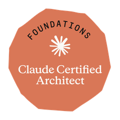</a>
  <a href="https://www.credly.com/badges/7831c9f3-98e1-4033-80e2-f513f55d2b79/public_url">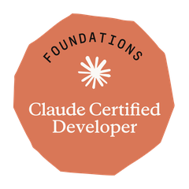</a>
  <a href="https://www.credly.com/badges/80a6df0f-b845-438d-ad56-a1dc92f09105/public_url">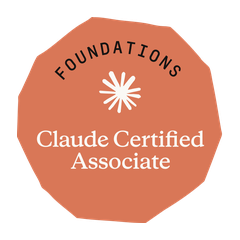</a>

<b>Claude ×4</b> (Anthropic), each valid for 12 months

  <a href="https://www.credly.com/badges/d0eea586-310e-42de-b162-6bca334f32bc/public_url">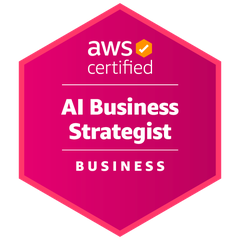</a>
  <a href="https://www.credly.com/badges/643bcb5e-e2ad-44d5-8b79-ea0115164bf6/public_url">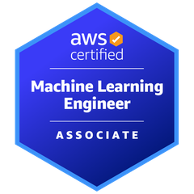</a>
  <a href="https://www.credly.com/badges/3c94d39e-88ad-4d43-883f-7a5d24202552/public_url">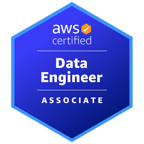</a>
  <a href="https://www.credly.com/badges/e6af41d0-42ad-4d10-b69d-463b5ab49595/public_url">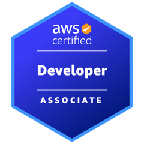</a>
  <a href="https://www.credly.com/badges/b7712add-2435-4375-9822-8657bb7277f1/public_url">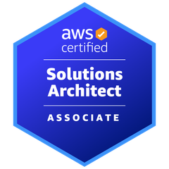</a>
  <a href="https://www.credly.com/badges/1d2d4acf-fff5-44be-bc4c-5143e40b8beb/public_url">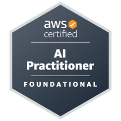</a>
  <a href="https://www.credly.com/badges/1265eca1-4d18-46d3-9bfc-797c6250c618/public_url">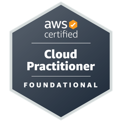</a>

<b>AWS ×7</b>

  <a href="https://www.credly.com/badges/e7ac9fff-b91e-410b-a57a-a3dab0960975/public_url">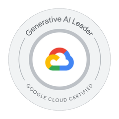</a>
  <a href="https://www.credly.com/badges/e4df3e36-0e84-4722-a0b4-43c8eed7cf25/public_url">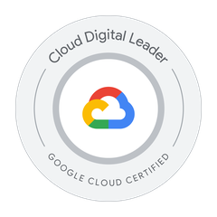</a>

<b>Google Cloud ×2</b>

## Tech stack

**Languages** &nbsp;&nbsp;    

**Backend & streaming** &nbsp;&nbsp;    

**AI / agentic** &nbsp;&nbsp;      

**Cloud & DevOps** &nbsp;&nbsp;      

**Data / databases** &nbsp;&nbsp;     

## Featured projects

| Project | What it does | Stack |
|---|---|---|
| [WealthPilot](https://github.com/Dilane-Kamga/Udacity-Product-Manager-Nanodegree-Program) (`Udacity-Product-Manager-Nanodegree-Program`) | The four graded projects of Udacity's Product Manager Nanodegree, run on one fictional product from pitch to launch; every checkable claim is tested in CI | Python · pytest · Playwright |
| [`brvm-mcp-server`](https://github.com/Dilane-Kamga/brvm-mcp-server) | Personal open-source MCP server exposing BRVM (West African regional stock exchange) market data to AI agents | Python · MCP |
| [`edgar-mcp`](https://github.com/Dilane-Kamga/edgar-mcp) | Personal MCP server for SEC EDGAR filings: typed outputs, section extraction, XBRL normalization, filing diffs | Python · MCP |
| [`OCPP-Simulator`](https://github.com/Dilane-Kamga/OCPP-Simulator) | OCPP 1.6J simulator: a local CSMS server and simulated charge points, built for a hackathon | Java · Spring Boot · WebSocket |
| [`low-level-design`](https://github.com/Dilane-Kamga/low-level-design) | Design patterns and low-level design practice | Java |

## GitHub activity

<!--
  assets/activity.svg is generated by scripts/render_activity.py (Python standard library only)
  in .github/workflows/profile-stats.yml, refreshed daily with the built-in GITHUB_TOKEN and
  committed to the repo, so it never depends on a live third-party service at render time.
  Private repositories are counted, never named.
-->

  

## Newsletter

> 📬 **Agentic AI Hebdo**: agentic AI in production, every Sunday on LinkedIn (in French, with an English TL;DR). 
> [**Subscribe on LinkedIn →**](https://www.linkedin.com/newsletters/agentic-ai-hebdo-7458444144026382337)
